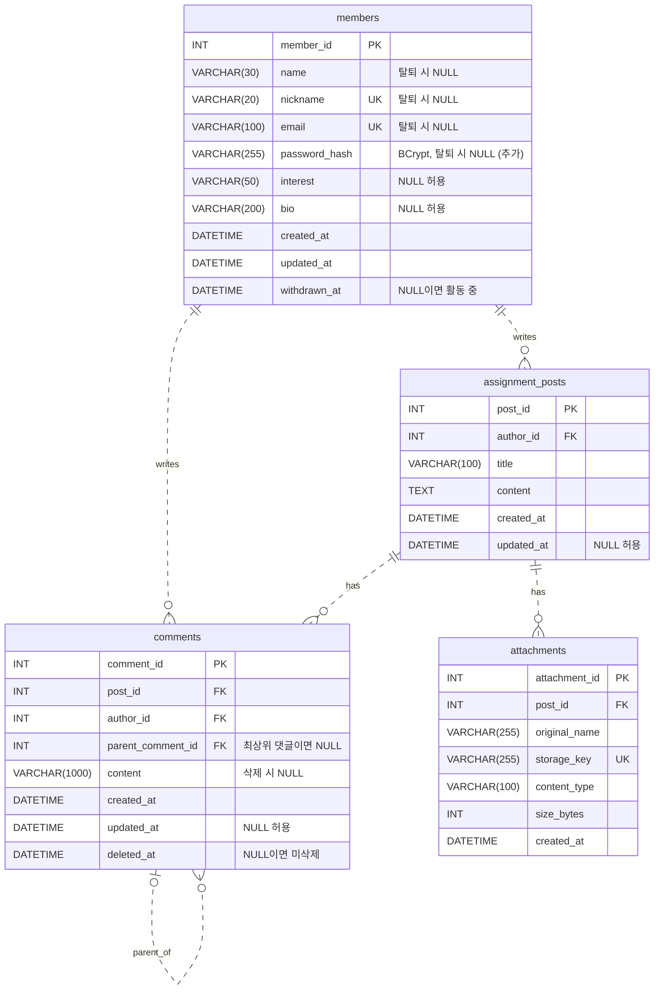

# ERD

> 예시 ERD를 기능 명세서·API 명세서와 대조해 고친 버전이다.

## 예시 ERD에서 바꾼 점

| 바꾼 곳 | 내용 | 이유 |
| --- | --- | --- |
| `members.password_hash` 추가 | `VARCHAR(255)`, 탈퇴 시 NULL | 로그인 기능(F-02)이 있는데 비밀번호 컬럼이 없었다. BCrypt 해시를 저장한다. |

## 대조하며 확인한 점 (변경 없음)

| 항목 | 확인 내용 |
| --- | --- |
| 탈퇴 (F-05) | 이름·닉네임·이메일을 NULL로 비우고 `withdrawn_at`을 기록한다. MySQL의 UNIQUE는 NULL 여러 개를 허용하므로 탈퇴자가 여러 명이어도 충돌하지 않고, 같은 이메일로 다시 가입할 수 있다. |
| 과제 삭제 (F-13) | `assignment_posts`에는 `deleted_at`이 없다. 완전 삭제와 맞는다. 외래키 때문에 댓글 → 첨부 → 과제 순서로 지운다. |
| 댓글 삭제 (F-18) | `deleted_at` 기록, `content` NULL. 소프트 삭제와 맞는다. |
| 답글 (F-16) | `parent_comment_id` 자기 참조. 1단계 제한과 "같은 과제의 댓글인지"는 DB가 막을 수 없어 서버에서 검사한다. |
| 첨부 크기 | `size_bytes INT`는 약 2GB까지 담는다. 파일 하나 10MB 제한에 충분하다. |
| 닉네임 중복 | 대소문자 무시 비교는 MySQL 기본 콜레이션(`utf8mb4_0900_ai_ci`)으로 처리된다. |

## 다이어그램

